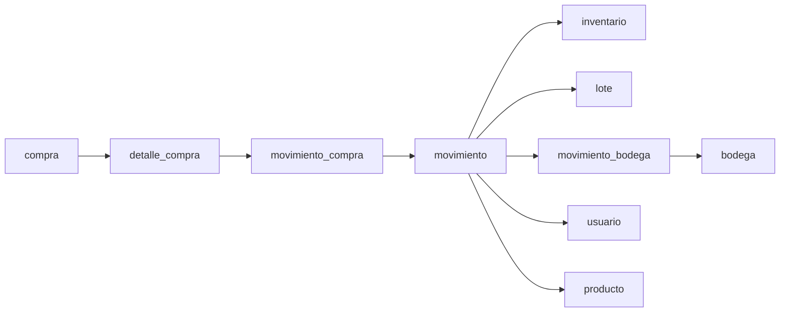

# Análisis técnico — Módulo Movimientos de Inventario (Fase 12.1)

**Fecha:** 2026-11-10  
**Proyecto:** `C:\Escritorio\BAD215\AgroFresh\AgroFresh2026-desarrollo`  
**Esquema de referencia:** PostgreSQL `inventario` (Supabase, vía perfil `local` sin exponer credenciales).

---

## 1. Objetivo y alcance

Auditoría **exclusivamente de lectura** para preparar el módulo **Movimientos de Inventario** (entradas, salidas, traslados, bajas por daño/vencimiento, historial).

**Alcance cubierto:** metadatos de tablas `movimiento`, `movimiento_bodega`, `movimiento_compra`; relaciones con inventario/lotes/compras; rutinas `sp_*` / `fn_*` relacionadas (definiciones inspeccionadas, **no ejecutadas**); código Java existente (inventario, lotes, recepción, traslados, seguridad).

**Fuera de alcance:** implementación de UI, servicios JPA del módulo, cambios de esquema, escrituras en Supabase, comandos Git.

**Maven:** no se ejecutó `mvn` en esta fase (sin modificación del proyecto).

---

## 2. Estado actual del esquema Supabase

| Fuente | Alcance | Etiqueta |
|---|---|---|
| Arranque local `DatabaseSchemaAuditor` (log 2026-11-10, proceso Spring) | Columnas y restricciones de tablas del esquema activo (`current_schema()`) | **VERIFICADO** (metadatos) |
| Consulta `information_schema` / `pg_proc` en transacción **READ ONLY** (misma sesión, sin invocar rutinas) | Listado de 19 rutinas `sp_*`/`fn_*`, permisos por rol, fragmentos de `pg_get_functiondef` | **VERIFICADO** (parcial en cuerpos largos) |
| Conteo o listado de filas de negocio | No realizado | **NO VERIFICADO** (por diseño de la fase) |

El esquema activo en conexión JDBC coincide con el catálogo documentado en `docs/CONFIGURACION_PERSISTENCIA.md` (tablas esperadas incluyen las tres de movimiento).

---

## 3. Estructura detallada — tablas principales

### 3.1 `movimiento`

| Columna | Tipo (catálogo) | Nullable | Default | Notas |
|---|---|---|---|---|
| `id_movimiento` | `integer` | NO | — | PK; generación en servidor (IDENTITY/SERIAL, patrón del proyecto) |
| `fecha` | `timestamptz` | NO | `CURRENT_TIMESTAMP` | |
| `tipo_movimiento` | `varchar(50)` | NO | — | Dominio por CHECK |
| `cantidad` | `integer` | NO | — | CHECK `cantidad > 0` |
| `id_bodega` | `integer` | NO | — | Bodega origen / ámbito del movimiento |
| `id_usuario` | `integer` | NO | — | FK → `usuario` |
| `id_producto` | `integer` | **Sí** | — | FK → `producto` (puede ser NULL en esquema) |
| `num_lote` | `integer` | **Sí** | — | Parte de FK compuesta a `lote` |

**Restricciones (VERIFICADO — log auditoría):**

- **PK:** `pk_movimiento (id_movimiento)`.
- **CHECK:** `ck_movimiento_cantidad` → `cantidad > 0`.
- **CHECK:** `ck_movimiento_tipo` → valores permitidos:  
  `'ENTRADA'`, `'SALIDA'`, `'TRASLADO'`, `'BAJA_VENCIMIENTO'`, `'BAJA_DAÑO'`.
- **FK:** `id_usuario` → `usuario`; `id_bodega` → `bodega`; `id_producto` → `producto`.
- **FK compuesta:** `(num_lote, id_bodega, id_producto)` → `lote(num_lote, id_bodega, id_producto)` (RESTRICT).

**Índices:** PK implica índice único en `id_movimiento`. Índices adicionales no se listaron en esta fase → **NO VERIFICADO** (índices secundarios).

**Campos de motivo/observaciones:** no aparecen en el inventario de columnas → **NO EXISTE** columna dedicada en `movimiento` (ámbito inspeccionado).

---

### 3.2 `movimiento_bodega`

| Columna | Tipo | Nullable | Rol |
|---|---|---|---|
| `id_movimiento` | `integer` | NO | PK y FK → `movimiento` (1:1 en PK) |
| `id_bodega_destino` | `integer` | NO | FK → `bodega` |

**Restricciones (VERIFICADO):**

- **PK:** `(id_movimiento)` — una fila de extensión por movimiento de traslado.
- **FK:** `id_movimiento` → `movimiento`; `id_bodega_destino` → `bodega`.

**Trigger (VERIFICADO — catálogo `pg_trigger`):** `trg_auditar_traslado` sobre `movimiento_bodega` (definición asociada a `fn_auditar_traslado`; **no ejecutado**).

---

### 3.3 `movimiento_compra`

| Columna | Tipo | Nullable | Rol |
|---|---|---|---|
| `id_movimiento` | `integer` | NO | FK → `movimiento` |
| `id_detalle_compra` | `integer` | NO | FK → `detalle_compra` |

**Restricciones (VERIFICADO):**

- **PK:** `(id_movimiento, id_detalle_compra)`.
- **FK:** ambas columnas con RESTRICT.

**Interpretación:** vincula un movimiento de tipo entrada (recepción) con la línea de compra que lo originó.

---

## 4. Relaciones con inventario, lotes, productos, bodegas y compras

### 4.1 Existencia por bodega — **VERIFICADO**

Tabla `inventario`:

- **PK:** `(id_bodega, id_producto)`.
- **Columnas:** `cantidad_actual` (default 0), `stock_minimo` (default 0).
- **CHECK:** `cantidad_actual >= 0`, `stock_minimo >= 0`.
- **FK:** bodega y producto.

La aplicación consulta existencias en `InventarioController` (JDBC, solo lectura) uniendo `inventario` + `producto` + `bodega`.

### 4.2 Lote en bodega — **VERIFICADO**

Tabla `lote`:

- **PK:** `(num_lote, id_bodega, id_producto)`.
- **Columnas:** `id_proveedor`, `fech_vencimiento`, `cantidad_recibida`, `cantidad_actual` (default 0).
- **CHECK:** `num_lote > 0`, `cantidad_recibida > 0`, `cantidad_actual >= 0`.
- **FK:** `lote.id_producto` → **`perecedero(id_producto)`** (lotes solo para perecederos en esquema).
- **FK:** bodega, proveedor.

`movimiento` referencia el mismo triple `(num_lote, id_bodega, id_producto)` cuando aplica.

### 4.3 Compras — **VERIFICADO**

- `compra` ↔ `detalle_compra` (líneas con `id_producto`, `cantidad`, precios).
- `movimiento_compra` enlaza `movimiento` con `detalle_compra` (entrada por compra).

### 4.4 Clasificación perecedero / no perecedero — **VERIFICADO**

- Subtipos `perecedero` / `no_perecedero` (1:1 con `producto`).
- `TrasladoService` y `RecepcionService` exigen exclusividad perecedero XOR no perecedero antes de llamar procedimientos distintos.
- Lotes y `fn_lotes_disponibles` aplican a perecederos (vencimiento, `cantidad_actual > 0`).

### 4.5 Diagrama lógico (resumen)

### 4.6 Registros huérfanos — **VERIFICADO**

FKs con `ON DELETE RESTRICT` / `ON UPDATE RESTRICT` en movimientos y tablas relacionadas (log auditoría). Borrados en cascada no previstos; integridad referencial obliga consistencia.

---

## 5. Funciones, procedimientos y triggers

### 5.1 Inventario de rutinas en esquema `inventario` (VERIFICADO — 19 rutinas)

| Nombre | Tipo | Relación con movimientos |
|---|---|---|
| `sp_crear_compra` | PROCEDURE | Cabecera de compra (preludio recepción) |
| `sp_recibir_perecedero` | PROCEDURE | Recepción + lote + movimiento ENTRADA |
| `sp_recibir_no_perecedero` | PROCEDURE | Recepción + movimiento ENTRADA |
| `sp_trasladar_perecedero` | PROCEDURE | TRASLADO con lote |
| `sp_trasladar_no_perecedero` | PROCEDURE | TRASLADO sin lote |
| `fn_validar_recepcion` | FUNCTION | Validaciones previas a recepción |
| `fn_validar_traslado` | FUNCTION | Validaciones previas a traslado |
| `fn_lotes_disponibles` | FUNCTION | Lotes con stock y vencimiento futuro (orden FEFO) |
| `fn_historial_traslados` | FUNCTION | Historial solo `tipo_movimiento = 'TRASLADO'` |
| `fn_auditar_traslado` | FUNCTION | Auditoría vía trigger en `movimiento_bodega` |
| `fn_tipo_producto` | FUNCTION | Soporte de clasificación |
| `fn_consultar_stock_bodega` | FUNCTION | Consulta stock |
| Otros (`fn_usuario_tiene_permiso`, `sp_crear_usuario`, …) | — | Seguridad / usuarios, no movimientos de stock |

**Búsqueda por nombre (`%baja%`, `%salida%`, `%entrada%` adicional a las ya listadas):** en el listado completo de 19 rutinas **NO EXISTE** un procedimiento dedicado con nombre `sp_salida`, `sp_baja_*` o `sp_entrada_manual` (ámbito inspeccionado). Los tipos `SALIDA`, `BAJA_*` están en CHECK de `movimiento` pero **NO VERIFICADO** qué rutina los inserta (podría ser lógica embebida solo en procedimientos no nombrados así, o **ausencia de implementación** en BD).

### 5.2 Rutinas exigidas por el enunciado

| Rutina | Estado |
|---|---|
| `sp_trasladar_perecedero` | **VERIFICADO** — existe; parámetros: origen, destino, producto, lote, cantidad, usuario. Cuerpo: `fn_validar_traslado`, bloqueo `FOR UPDATE` en bodegas, revalidación, inserción en `movimiento` / actualización stock (fragmento inspeccionado). |
| `sp_trasladar_no_perecedero` | **VERIFICADO** — análogo sin lote. |
| `fn_historial_traslados` | **VERIFICADO** — retorna tabla con joins `movimiento`, `movimiento_bodega`, producto, bodegas origen/destino, usuario; filtro `TRASLADO`. |

### 5.3 Recepción (entradas por compra) — **VERIFICADO**

Invocadas desde `RecepcionService` (`@Transactional`):

1. `CALL sp_crear_compra(?, NULL)` → `id_compra`.
2. Por línea: `CALL sp_recibir_perecedero(...)` o `sp_recibir_no_perecedero(...)`.

Los procedimientos de recepción inspeccionados: bloquean `compra`, llaman `fn_validar_recepcion`, manipulan `detalle_compra`, `inventario`, `lote` (perecedero), `movimiento`, `movimiento_compra` (según fragmentos de definición).

### 5.4 Traslados en aplicación — **VERIFICADO**

- `TrasladoService.trasladar` → `CALL sp_trasladar_perecedero` / `sp_trasladar_no_perecedero`.
- Permiso aplicación: recurso **`traslado`**, acción **`INSERT`** (no `movimiento`).
- `TrasladoCatalogoController` usa `fn_lotes_disponibles` (orden por `fech_vencimiento`).

### 5.5 Transacciones y errores — **VERIFICADO** (diseño)

- Servicios Java: `@Transactional` en recepción y traslado.
- Procedimientos PL/pgSQL: `RAISE EXCEPTION` en validaciones (ej. compra inexistente).
- PostgreSQL: operación atómica por llamada `CALL` desde la transacción Spring.

### 5.6 Triggers — **VERIFICADO**

- `trg_auditar_traslado` en `movimiento_bodega` (único trigger listado en tablas inspeccionadas de movimiento).

---

## 6. Análisis del código Java existente

### 6.1 Inventario

| Elemento | Detalle |
|---|---|
| `InventarioController` | `GET /inventario` — JDBC read-only sobre `inventario` + filtros. |
| Entidad JPA `Inventario` | **NO EXISTE** en el proyecto (patrón JDBC para stock). |

### 6.2 Lotes

| Elemento | Detalle |
|---|---|
| `LotesController` | `GET /lotes` — SQL directo a `lote` + joins; estados calculados (vigente/próximo/vencido/sin stock). |
| FEFO en UI de traslados | `fn_lotes_disponibles` en API traslados, no en listado de lotes. |

### 6.3 Compras / recepción

| Elemento | Detalle |
|---|---|
| `RecepcionController` | Vista `recepcion`, APIs catálogo, `POST /api/compras/confirmar`. |
| `RecepcionService.registrar` | Procedimientos almacenados; permiso `compra` + `INSERT`. |
| Registro de movimientos | **VERIFICADO** indirectamente vía `sp_recibir_*` (definiciones PL/pgSQL). |

### 6.4 Traslados (parcial del módulo movimientos)

| Elemento | Detalle |
|---|---|
| `TrasladoController` | Vista `traslados.html`. |
| `TrasladoOperacionController` | `POST /api/traslados/confirmar`. |
| `TrasladoCatalogoController` | Bodegas, productos con stock, lotes disponibles. |
| Historial | `fn_historial_traslados` **NO** referenciado en Java inspeccionado → **NO EXISTE** pantalla/API de historial en la app. |

### 6.5 Módulo `/movimientos` (placeholder)

| Elemento | Detalle |
|---|---|
| `ModuloController` | `GET /movimientos` → `modulo-pendiente` (mismo patrón que reportes). |
| `sidebar.html` | Enlace `/movimientos` con `accesos['movimiento']`, etiqueta «Pendiente». |
| Entidad/DTO `Movimiento` | **NO EXISTE**. |

### 6.6 Productos y dependencias de movimientos

`ProductoRepository.tieneMovimientos` — `EXISTS` en `movimiento` por `id_producto`.  
`ProductoServiceImpl` bloquea cambio de clasificación si hay movimientos.

### 6.7 Seguridad transversal

- `PermisoService` → `fn_usuario_tiene_permiso(usuario, recurso, accion)`.
- `SecurityConfig`: POST traslados → `traslado.INSERT`; bucle genérico `/movimientos/**` → `movimiento.ACCEDER`.
- Recurso `movimiento` en `SessionModelAdvice.accesos`.

### 6.8 Respuestas a las diez preguntas del enunciado

| # | Pregunta | Hallazgo |
|---|---|---|
| 1 | Actualización de inventario | **VERIFICADO** — vía procedimientos `sp_recibir_*` y `sp_trasladar_*` (no desde controladores MVC de inventario). |
| 2 | Actualización de lotes | **VERIFICADO** — recepción perecedero y traslado perecedero (procedimientos). |
| 3 | Recepción registra movimientos | **VERIFICADO** — definiciones `sp_recibir_*` + tabla `movimiento_compra`. |
| 4 | Salidas / traslados en app | Traslados **VERIFICADO**; salidas **NO EXISTE** en Java. |
| 5 | JDBC vs JPA vs SP | Stock/movimientos: **JDBC + CALL**; catálogo productos/proveedores: **JPA**. |
| 6 | `@Transactional` | Recepción y traslado **VERIFICADO**. |
| 7 | Existencias negativas | CHECK `inventario.cantidad_actual >= 0`, `lote.cantidad_actual >= 0`, `movimiento.cantidad > 0`; validación en `fn_validar_*` **VERIFICADO** (existencia). |
| 8 | FEFO | **VERIFICADO** en `fn_lotes_disponibles` (`ORDER BY fech_vencimiento`). |
| 9 | Historial | Solo **VERIFICADO** función `fn_historial_traslados` (traslados); **NO EXISTE** historial unificado en app. |
| 10 | Reutilización | Reutilizar patrones de `RecepcionService` / `TrasladoService`, `PermisoService`, vistas `traslados` / `recepcion`; nuevo trabajo en `/movimientos`, salidas, bajas, historial global. |

---

## 7. Análisis de seguridad y permisos

### 7.1 Recurso `movimiento` (VERIFICADO — consulta `permiso` + `rol_permiso` + `rol`)

| Acción | ADMINISTRADOR | OPERATIVO |
|---|---|---|
| ACCEDER | Sí | Sí |
| SELECT | Sí | Sí |
| INSERT | Sí | Sí |
| UPDATE | Sí | **No** (no aparece fila OPERATIVO) |
| DELETE | Sí | **No** |

Códigos: par `(recurso='movimiento', accion)` con acciones del CHECK global de permisos (`SELECT`, `INSERT`, `UPDATE`, `DELETE`, `ACCEDER`).

### 7.2 Recursos relacionados (VERIFICADO)

- **`traslado`:** OPERATIVO tiene `INSERT` + `SELECT` + `ACCEDER` (coherente con traslados operativos).
- **`compra`:** OPERATIVO puede `INSERT` (recepción).
- **`inventario`**, **`lote`:** OPERATIVO lectura/ACCESO; escritura vía procedimientos + permisos de compra/traslado/movimiento según flujo.

### 7.3 Integración en aplicación

- Pantalla `/movimientos`: solo exige `movimiento.ACCEDER` (matcher genérico en `SecurityConfig`).
- Operaciones reales hoy usan permisos **`compra.INSERT`** y **`traslado.INSERT`**, no `movimiento.INSERT` en controladores inspeccionados.
- **Riesgo de diseño (PROPUESTA):** al implementar salidas/bajas/historial, definir si exigen `movimiento.INSERT`/`SELECT` además de acciones específicas ya usadas en recepción/traslado.

---

## 8. Matriz de viabilidad funcional

| Operación | Estructura disponible | Lógica existente | Trabajo pendiente |
|---|---|---|---|
| Entrada por compra | **VERIFICADO** (`movimiento`, `movimiento_compra`, compras) | **VERIFICADO** `RecepcionService` + `sp_recibir_*` | UI ya en `recepcion`; integrar en módulo movimientos solo si se centraliza historial |
| Entrada manual | **VERIFICADO** tipo `ENTRADA` en CHECK | **NO EXISTE** procedimiento/app dedicados nombrados en catálogo | Diseñar flujo (¿SP nuevo o reutilizar patrón?) y permisos |
| Salida | **VERIFICADO** tipo `SALIDA` en CHECK | **NO EXISTE** en Java; **NO EXISTE** `sp_salida` en listado de rutinas | Implementar en BD (si falta SP) + capa servicio + UI |
| Traslado | **VERIFICADO** `movimiento` + `movimiento_bodega` | **VERIFICADO** `TrasladoService` + `sp_trasladar_*` | Exponer en módulo movimientos / historial; ya operativo en `/traslados` |
| Baja por daño | **VERIFICADO** `BAJA_DAÑO` en CHECK | **NO EXISTE** SP/UI | Motivo: **NO EXISTE** columna observaciones en `movimiento` |
| Baja por vencimiento | **VERIFICADO** `BAJA_VENCIMIENTO` en CHECK | **NO EXISTE** SP/UI | Posible automatización batch → **NO VERIFICADO** |
| Historial | **VERIFICADO** tabla `movimiento` | **PARCIAL** `fn_historial_traslados` solo traslados; **NO EXISTE** vista unificada | API/UI consulta con `movimiento.SELECT`; posible extensión de funciones |

---

## 9. Reglas de negocio identificadas

| Regla | Evidencia | Etiqueta |
|---|---|---|
| Cantidades de movimiento siempre positivas | `ck_movimiento_cantidad` | **VERIFICADO** |
| Tipos de movimiento cerrados (5 valores) | `ck_movimiento_tipo` | **VERIFICADO** |
| Inventario y lote no negativos | CHECK en tablas | **VERIFICADO** |
| Traslado exige bodegas distintas y producto clasificado | `TrasladoService` | **VERIFICADO** |
| Perecedero exige lote en traslado | `TrasladoService` + `sp_trasladar_perecedero` | **VERIFICADO** |
| Recepción atómica multi-línea | `RecepcionService` `@Transactional` | **VERIFICADO** |
| Entrada por compra enlazada a detalle | `movimiento_compra` | **VERIFICADO** |
| Traslado genera extensión en `movimiento_bodega` | Esquema + `fn_historial_traslados` | **VERIFICADO** |
| Historial de traslados auditable | Trigger `trg_auditar_traslado` | **VERIFICADO** (existencia) |
| Motivo textual en bajas | Sin columna en `movimiento` | **NO EXISTE** / limitación |

---

## 10. Riesgos técnicos y posibles duplicaciones

| Riesgo | Descripción | Etiqueta |
|---|---|---|
| Doble actualización de stock | Mitigado por validación + bloqueos en SP (traslado/recepción) | **VERIFICADO** (diseño SP) |
| Permiso `traslado` vs `movimiento` | Traslados no usan `movimiento.INSERT` en app actual | **VERIFICADO** |
| Recurso duplicado en SecurityConfig | `categorias` mapeado a permiso `producto` | **VERIFICADO** (preexistente, no movimientos) |
| JDBC sin entidad `Movimiento` | Inconsistencia con módulos JPA (productos/proveedores) | **VERIFICADO** |
| Tipos `SALIDA`/`BAJA_*` sin SP expuesto | Riesgo de implementación incompleta en BD | **PROPUESTA** |
| Pooler Supabase | Consultas secundarias (índices, cuerpos completos de SP) pueden fallar intermitente | **NO VERIFICADO** en segundo intento bloqueado |

---

## 11. Limitaciones de la base de datos

1. **Sin campo observaciones/motivo** en `movimiento` para bajas con texto libre (salvo **PROPUESTA** usar `bitacora` o extensión futura autorizada).
2. **Diferenciar entrada manual vs compra:** presencia/ausencia de fila en `movimiento_compra` (**VERIFICADO** mecanismo); no hay columna `tipo_origen` adicional.
3. **Lotes** atados a **perecederos** por FK (`lote` → `perecedero`).
4. **Historial** formal en BD solo inspeccionado para traslados vía `fn_historial_traslados` (**VERIFICADO**).

---

## 12. Decisiones que requieren confirmación

1. ¿El módulo `/movimientos` unifica recepción/traslados existentes o convive con pantallas actuales?
2. ¿Salidas y bajas se implementan solo con nuevos procedimientos en Supabase (requiere etapa de migración **autorizada**) o solo capa Java?
3. ¿Motivo de baja sin columna nueva — bitácora, catálogo o cambio de esquema?
4. ¿Historial global consulta `movimiento` con filtros o se extienden funciones tipo `fn_historial_*`?
5. ¿OPERATIVO podrá registrar salidas/bajas (`movimiento.INSERT` ya concedido) o solo ADMIN?

---

## 13. Propuesta de organización de siguientes fases (PROPUESTA — no autorizada)

| Fase | Contenido sugerido |
|---|---|
| 12.2 | Diseño técnico: rutas MVC, permisos `movimiento` vs `traslado`/`compra`, DTO de historial, contrato con SP existentes |
| 12.3 | Backend: servicios JDBC, consultas historial, endpoints salida/baja **solo si** existen o se autorizan SP |
| 12.4 | Interfaz: historial, formularios salida/baja, integración sidebar (quitar «Pendiente») |
| 12.5 | Seguridad y pruebas MockMvc + regresión Maven |
| Opcional BD | SP para `SALIDA` / `BAJA_*` si confirmada ausencia — **requiere migración explícita** |

---

## 14. Archivos consultados (sin modificación)

**Código:** `InventarioController`, `LotesController`, `RecepcionController`, `RecepcionService`, `TrasladoController`, `TrasladoCatalogoController`, `TrasladoOperacionController`, `TrasladoService`, `ModuloController`, `SecurityConfig`, `PermisoService`, `SessionModelAdvice`, `ProductoRepository`, `ProductoServiceImpl`, `DatabaseSchemaAuditor`.

**Plantillas:** `inventario.html`, `lotes.html`, `recepcion.html`, `traslados.html`, `modulo-pendiente.html`, `layout/sidebar.html`.

**Documentación previa:** `CONFIGURACION_PERSISTENCIA.md`, `INFORME_FASE_8_VALIDACION_FUNCIONAL.md`, `INFORME_INTEGRACION_MEJORAS_LOTES.md`.

**Log local:** salida `DatabaseSchemaAuditor` en arranque Spring (2026-11-10).

---

## 15. Consultas de solo lectura realizadas

1. Metadatos vía arranque aplicación (`information_schema` / `pg_constraint` en `DatabaseSchemaAuditor`).
2. Una sesión PostgreSQL `readonly=true`: listado de rutinas `sp_*`/`fn_*`, permisos por rol para recursos `movimiento`, `traslado`, `compra`, `inventario`, `lote`; fragmentos de `pg_get_functiondef` para procedimientos clave (**sin** `CALL` ni `SELECT` de filas de negocio).
3. Catálogo de triggers en tablas de movimiento (conteo: 1 en `movimiento_bodega`).

**No ejecutado:** `mvn`, Git, INSERT/UPDATE/DELETE, invocación de procedimientos almacenados.

---

## 16. Confirmaciones finales

- **No se modificó** código Java, HTML, CSS, SQL del proyecto ni `config/application-local.properties`.
- **No se escribió** en Supabase.
- **No se ejecutaron** comandos Git.
- **Único archivo creado:** `docs/ANALISIS_MODULO_MOVIMIENTOS_FASE_12_1.md`.

---

## Conclusión de la fase 12.1

**COMPLETADA** respecto al alcance de auditoría y documentación, con estas salvedades marcadas como **NO VERIFICADO**: índices secundarios detallados, cuerpos completos de todos los procedimientos, procedimientos explícitos para salida/baja, y conteos de datos reales.

El módulo Movimientos en la aplicación sigue en **placeholder** (`/movimientos`), mientras que **entradas por compra** y **traslados** ya están implementados en rutas dedicadas apoyadas en procedimientos almacenados verificados.

**DETENIDO** — sin implementación 12.2 hasta autorización expresa.
