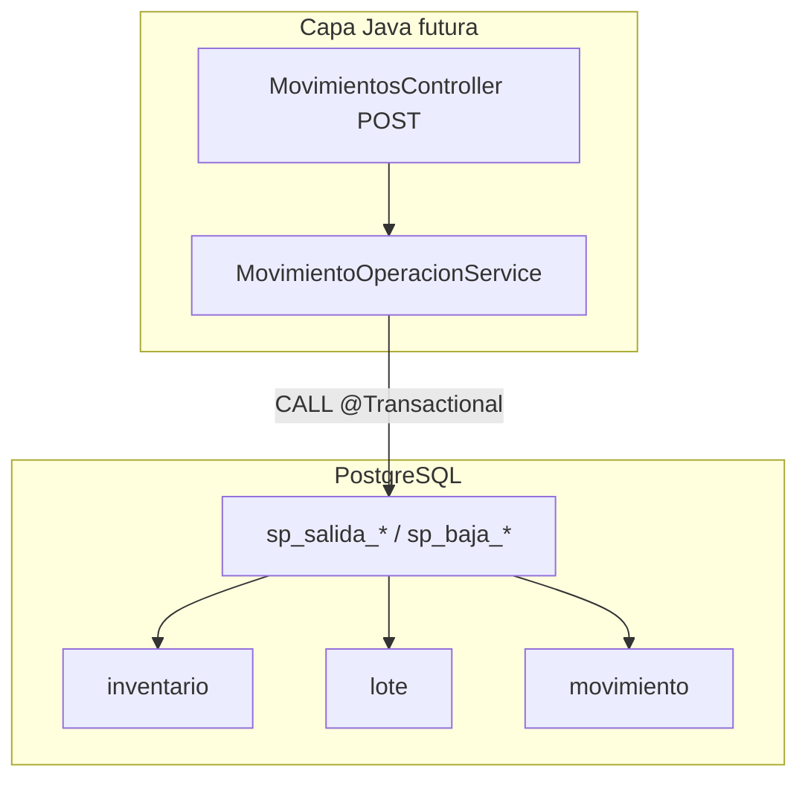

# Diseño técnico — Operaciones de salida y bajas de inventario (Fase 12.4)

**Fecha:** 2026-11-10  
**Proyecto:** AGROFRESH — `AgroFresh2026-desarrollo`  
**Referencias:** `docs/ANALISIS_MODULO_MOVIMIENTOS_FASE_12_1.md`, `docs/DISENO_TECNICO_MODULO_MOVIMIENTOS.md`, `docs/INFORME_FASE_12_3.md`, `docs/CONFIGURACION_PERSISTENCIA.md`  
**Estado:** Solo análisis y diseño. **No** se modificó Supabase ni código funcional.

### Leyenda

| Marca | Significado |
|---|---|
| **VERIFICADO** | Comprobado en auditoría 12.1, metadatos del esquema, o código Java inspeccionado. |
| **PROPUESTA** | Diseño recomendado para fase 12.5; requiere autorización de migración/ejecución. |
| **PENDIENTE** | Decisión del usuario o inspección adicional no realizada en 12.4. |
| **NO EXISTE** | Ausente en el ámbito inspeccionado. |

---

## 1. Objetivo

Definir el diseño técnico de:

1. **Salida normal** (`tipo_movimiento = 'SALIDA'`).
2. **Baja por daño** (`'BAJA_DAÑO'`).
3. **Baja por vencimiento** (`'BAJA_VENCIMIENTO'`).

Garantizando **consistencia transaccional**, **integridad de existencias**, **trazabilidad** (`movimiento` + relaciones) y **control de permisos** alineado a la distribución funcional aprobada, **sin implementar** procedimientos, Java de escritura ni cambios en Supabase en esta fase.

La Fase 12.3 ya expone el historial de lectura; las operaciones diseñadas aquí deben aparecer allí tras ejecutarse vía procedimientos.

---

## 2. Esquema real inspeccionado

### 2.1 Fuentes de inspección (12.4)

| Fuente | Alcance |
|---|---|
| Auditoría 12.1 (`ANALISIS_MODULO_MOVIMIENTOS_FASE_12_1.md`) | Tablas movimiento, FKs, CHECK, catálogo de 19 rutinas `sp_*`/`fn_*`. |
| `DatabaseSchemaAuditor` / `CONFIGURACION_PERSISTENCIA.md` | 16 tablas, 63 restricciones, tipos reales (`timestamptz`, `integer`). |
| `RecepcionService`, `TrasladoService` | Patrón `CALL` y resolución de `id_usuario`. |
| `TrasladoCatalogoController` | `fn_lotes_disponibles` (FEFO en traslados). |
| `LotesController` | Criterio **VENCIDO**: `fech_vencimiento <= CURRENT_DATE`. |
| `MovimientoRepository` (12.3) | Columnas usadas en historial (sin columnas de motivo). |

**No ejecutado en 12.4:** nueva sesión read-only a Supabase ni `pg_get_functiondef` completo de todos los SP (se reutiliza evidencia 12.1).

### 2.2 Hallazgos de consistencia documentación vs catálogo real

| Tema | SQL legado / doc antigua | Catálogo remoto **VERIFICADO** |
|---|---|---|
| `movimiento.fecha` | `DATE` | `timestamptz`, default `CURRENT_TIMESTAMP` |
| `movimiento.cantidad` | `DECIMAL` | `integer`, CHECK `> 0` |
| `lote` | sin `cantidad_actual` en SQL | `cantidad_actual` con default `0`, CHECK `>= 0` |
| Identidades | `SERIAL` | `GENERATED ALWAYS AS IDENTITY` (patrón vigente) |

El diseño de procedimientos usa tipos **del catálogo remoto**, no del script histórico.

### 2.3 Tablas sin “detalle de movimiento” genérico

**VERIFICADO:** no existe tabla `detalle_movimiento`. El “detalle” operativo se modela así:

| Extensión | Cuándo |
|---|---|
| `movimiento` (fila única) | Todos los tipos |
| `movimiento_bodega` | Solo `TRASLADO` |
| `movimiento_compra` | `ENTRADA` por recepción |

Salidas y bajas → **una fila** en `movimiento` por unidad atómica de negocio (véase §5 multi-lote).

### 2.4 Índices y triggers

- **Índices secundarios** en `movimiento`: **NO VERIFICADO** en detalle (12.1); PK en `id_movimiento` **VERIFICADO**.
- **Trigger** en tablas de movimiento inspeccionadas: `trg_auditar_traslado` en `movimiento_bodega` **VERIFICADO** (no aplica a salida/baja).
- **NO EXISTE** trigger genérico en `movimiento` para salidas/bajas.

### 2.5 Motivo / descripción del daño

**VERIFICADO — NO EXISTE** columna de motivo, observaciones o referencia en `movimiento`.

| Alternativa | Estado |
|---|---|
| Persistir motivo en `movimiento` | Requiere migración **no autorizada** |
| Tabla `bitacora` (`descripcion VARCHAR(200)`) | **VERIFICADO** en catálogo; **NO EXISTE** integración en app para movimientos |
| Motivo solo en UI (no persistido) | **PROPUESTA** rechazada para bajas administrativas |
| INSERT en `bitacora` desde SP de baja daño | **PROPUESTA** opcional en 12.5 si se autoriza uso de bitácora |

---

## 3. Tablas y relaciones involucradas

### 3.1 Núcleo de existencias

| Tabla | PK | Rol en salida/baja |
|---|---|---|
| `inventario` | `(id_bodega, id_producto)` | `cantidad_actual` agregada por bodega-producto |
| `lote` | `(num_lote, id_bodega, id_producto)` | Solo perecederos; FK `id_producto` → `perecedero` |
| `producto` | `id_producto` | Existencia y validación de código |
| `perecedero` / `no_perecedero` | `id_producto` | Clasificación exclusiva **VERIFICADA** en Java |
| `bodega` | `id_bodega` | Origen de la operación |
| `usuario` | `id_usuario` | Responsable; `activo`, `bloqueado` **VERIFICADOS** en servicios |

### 3.2 Registro histórico

| Tabla | Campos relevantes |
|---|---|
| `movimiento` | `tipo_movimiento`, `cantidad`, `id_bodega`, `id_producto`, `num_lote` (nullable), `id_usuario`, `fecha` |
| CHECK `ck_movimiento_tipo` | `ENTRADA`, `SALIDA`, `TRASLADO`, `BAJA_VENCIMIENTO`, `BAJA_DAÑO` |
| CHECK `ck_movimiento_cantidad` | `cantidad > 0` |

### 3.3 FK compuesta movimiento → lote

**VERIFICADO:** si `num_lote` no es NULL, debe existir `lote(num_lote, id_bodega, id_producto)` coherente con `movimiento`.

### 3.4 Diagrama de escritura propuesto



---

## 4. Mecanismos actuales de actualización del inventario

| Operación | Mecanismo | Java |
|---|---|---|
| Entrada por compra | `sp_crear_compra` + `sp_recibir_perecedero` / `sp_recibir_no_perecedero` | `RecepcionService` |
| Traslado | `sp_trasladar_perecedero` / `sp_trasladar_no_perecedero` | `TrasladoService` |
| Consulta stock | `inventario`, `fn_consultar_stock_bodega`, `fn_lotes_disponibles` | Lectura JDBC |
| Salida / bajas | **NO EXISTE** SP nombrado en catálogo de 19 rutinas (12.1) | **NO EXISTE** |

**VERIFICADO** (fragmentos 12.1): `sp_trasladar_*` invoca `fn_validar_traslado`, usa **bloqueo `FOR UPDATE`** sobre filas de stock, y en una transacción PL/pgSQL: inserta `movimiento` (+ `movimiento_bodega`) y actualiza `inventario` / `lote`.

**Principio de proyecto:** la **fuente de verdad** de la mutación es PostgreSQL; Java no debe ejecutar `UPDATE inventario` / `UPDATE lote` / `INSERT movimiento` directo para estas operaciones.

---

## 5. Diseño de salida normal

### 5.1 Parámetros de negocio

| Campo | Origen | Notas |
|---|---|---|
| Producto | Formulario / API | Obligatorio |
| Bodega origen | Formulario | `movimiento.id_bodega` |
| Lote | Formulario si perecedero | `movimiento.num_lote`; NULL si no perecedero |
| Cantidad | Formulario | Entero > 0 |
| Usuario responsable | Sesión (`username` → `id_usuario`) | **VERIFICADO** patrón Traslado/Recepción |
| Fecha/hora | `movimiento.fecha` default BD | No enviar desde cliente |
| Motivo / referencia | — | **NO EXISTE** columna; sin persistencia salvo bitácora **PENDIENTE** |

No se usa `movimiento_bodega` ni `movimiento_compra`.

### 5.2 Reglas por clasificación de producto

| Clasificación | Lote | Actualización |
|---|---|---|
| Perecedero | Obligatorio, triple válido en `lote` | Decrementar `lote.cantidad_actual` e `inventario.cantidad_actual` |
| No perecedero | `num_lote` NULL en `movimiento` | Solo `inventario.cantidad_actual` |

**VERIFICADO:** misma bifurcación que traslado (`TrasladoService`).

### 5.3 Validaciones (orden recomendado en SP + previas en Java)

| # | Validación | Dónde |
|---|---|---|
| 1 | Bodega, producto, cantidad > 0 | Java + SP |
| 2 | Producto existe | SP |
| 3 | Clasificación exclusiva perecedero XOR no_perecedero | Java (como traslado) + SP defensivo |
| 4 | Usuario activo, no bloqueado | Java |
| 5 | Perecedero → lote > 0 y fila `lote` existe para (lote, bodega, producto) | SP |
| 6 | `inventario.cantidad_actual >= cantidad` | SP tras bloqueo |
| 7 | Perecedero → `lote.cantidad_actual >= cantidad` | SP tras bloqueo |
| 8 | Resultado ≥ 0 en ambas tablas | CHECK BD + SP |
| 9 | Tipo movimiento `SALIDA` al insertar | SP |

**PROPUESTA — política vencimiento en salida normal:** rechazar salida desde lote con `fech_vencimiento <= CURRENT_DATE` (alineado a `fn_lotes_disponibles`, que excluye vencidos para traslados). **PENDIENTE** confirmación de negocio (¿permitir salida de vencido como consumo urgente?).

### 5.4 Selección de lotes y FEFO

| Escenario | Diseño **PROPUESTO** |
|---|---|
| **Salida estándar (12.5 inicial)** | Usuario elige **un lote** en UI; catálogo vía consulta similar a `fn_lotes_disponibles` o lotes con `cantidad_actual > 0` ordenados por `fech_vencimiento` (sugerencia FEFO en UI, no auto-asignación). |
| **Salida multi-lote** | **PENDIENTE** fase posterior: un SP que itera lotes en orden FEFO hasta cubrir cantidad total; **un `movimiento` por cada lote** consumido (restricción FK). Toda la iteración en **una transacción** PL/pgSQL. |
| **FEFO automático** | **VERIFICADO** en `fn_lotes_disponibles` para traslados; **PROPUESTA** reutilizar orden `ORDER BY fech_vencimiento, num_lote` en lógica multi-lote. |

### 5.5 Roles

| Rol | Salida normal |
|---|---|
| OPERATIVO | **Permitido** (distribución aprobada) |
| ADMINISTRADOR | **Permitido** |

Autorización: `movimiento.INSERT` **VERIFICADO** para ambos roles en Supabase (12.1) + rutas dedicadas en `SecurityConfig` (fase 12.5).

---

## 6. Diseño de baja por daño

### 6.1 Datos de la operación

Igual que salida en dimensiones de stock (producto, bodega, lote si perecedero, cantidad), con `tipo_movimiento = 'BAJA_DAÑO'`.

| Campo solicitado en enunciado | Persistencia |
|---|---|
| Descripción del daño | **NO EXISTE** en `movimiento` |
| Histórico | Fila `movimiento` + aparición en historial 12.3 |

**PROPUESTA:** si se requiere texto, `INSERT` en `bitacora` en el mismo SP (`tipo_accion = 'BAJA_DAÑO'`, `tabla_afectada = 'movimiento'`, `descripcion` truncada a 200). **PENDIENTE** autorización y política de retención.

### 6.2 Validaciones

Mismas que salida (existencias, lote, cantidad > 0). No exige lote vencido.

### 6.3 Roles

| Rol | Baja daño |
|---|---|
| OPERATIVO | **No** (distribución aprobada) |
| ADMINISTRADOR | **Sí** |

**PROPUESTA seguridad (sin cambiar permisos BD en 12.4):** endpoints `POST .../baja-dano/...` exigen rol **ADMINISTRADOR** vía `PermisoService` + comprobación de recurso `movimiento` y **denegación explícita** si el rol es OPERATIVO, aunque tenga `INSERT`. Alternativa: nueva acción en modelo de permisos — **PENDIENTE** (implicaría migración de `permiso`).

---

## 7. Diseño de baja por vencimiento

### 7.1 Alcance

Solo **perecederos** con fila en `lote`.

### 7.2 Validación de vencimiento

**VERIFICADO** (LotesController):

```sql
fech_vencimiento <= CURRENT_DATE  -- estado 'VENCIDO'
```

**PROPUESTA SP:** rechazar baja vencimiento si `fech_vencimiento > CURRENT_DATE` (código error `LOTE_NO_VENCIDO`).

### 7.3 Cantidad

`cantidad <= lote.cantidad_actual` y coherencia con `inventario` (mismo patrón que salida).

### 7.4 Roles

Solo **ADMINISTRADOR** (misma estrategia de endpoint que baja daño).

---

## 8. Diseño transaccional

### 8.1 Unidad atómica

**PROPUESTA:** cada `CALL` a un procedimiento de salida/baja es **una transacción** PostgreSQL. Spring envuelve con `@Transactional(rollbackFor = Exception.class)` como `RecepcionService` **VERIFICADO**.

Pasos atómicos dentro del SP:

1. Validaciones sin efecto (lectura).
2. Bloqueos (`FOR UPDATE`) en `inventario` y, si aplica, `lote`.
3. Revalidación de cantidades.
4. `UPDATE` existencias.
5. `INSERT` en `movimiento`.
6. (Opcional) `INSERT` en `bitacora` para baja daño.

Si falla cualquier paso → `RAISE EXCEPTION` → rollback total; **no** debe quedar inventario decrementado sin movimiento.

### 8.2 Multi-lote (futuro)

Un solo procedimiento con bucle: varios `INSERT movimiento` + varios `UPDATE lote`; **un** `UPDATE inventario` con suma total o varios updates consistentes; todo en el mismo bloque `BEGIN … EXCEPTION … END`.

---

## 9. Estrategia de concurrencia

### 9.1 Evidencia existente

**VERIFICADO (12.1):** `sp_trasladar_*` usa bloqueo de filas antes de mutar.

### 9.2 **PROPUESTA** para salidas/bajas

| Recurso | Bloqueo |
|---|---|
| `inventario` | `SELECT … FOR UPDATE` sobre PK `(id_bodega, id_producto)` |
| `lote` (perecedero) | `SELECT … FOR UPDATE` sobre PK compuesta |
| Orden de bloqueo | Siempre `inventario` luego `lote` (orden fijo anti-deadlock) |

Nivel de aislamiento: **READ COMMITTED** (default PostgreSQL) con revalidación post-bloqueo **VERIFICADO** como patrón en traslados.

### 9.3 Condición de carrera

Dos sesiones solicitando la misma cantidad: la segunda debe fallar con **existencias insuficientes** tras bloqueo, no con inventario negativo (CHECK lo impediría con error de integridad — evitar llegar a ese punto).

### 9.4 Concurrencia Java

Un solo hilo de request por operación; sin caché de stock en memoria. La serialización efectiva ocurre en BD.

---

## 10. Procedimientos propuestos

### 10.1 Convención de nombres

**VERIFICADO:** prefijo `sp_` + verbo + sufijo `_perecedero` / `_no_perecedero` cuando la lógica diverge.

**PROPUESTA:** tres parejas o tres procedimientos unificados:

| Opción | Ventaja | Inconveniente |
|---|---|---|
| **A — Separados (recomendado)** | `sp_salida_perecedero`, `sp_salida_no_perecedero`, `sp_baja_dano_perecedero`, … | Más rutinas en catálogo |
| **B — Un SP con parámetro `p_tipo_movimiento`** | Un solo punto de mantenimiento | Riesgo de mezclar reglas de negocio y permisos por tipo |

**Recomendación:** **Opción A** para salida (espejo de traslado); **Opción B o SP dedicados** para bajas (menos ramas).

### 10.2 Procedimientos mínimos **PROPUESTOS** (DISEÑO NO EJECUTABLE)

#### `sp_salida_perecedero`

| Aspecto | Detalle |
|---|---|
| Responsabilidad | Registrar `SALIDA` y decrementar lote + inventario |
| Entrada | `(p_id_bodega, p_id_producto, p_num_lote, p_cantidad, p_id_usuario)` |
| Salida opcional | `OUT p_id_movimiento integer` |
| Validaciones | §5.3 + lote no vencido **PROPUESTA** |
| Tablas | `lote`, `inventario`, `movimiento`, `producto`, `perecedero`, `bodega`, `usuario` |
| Bloqueos | `inventario`, `lote` FOR UPDATE |
| Errores | Ver §12 |

#### `sp_salida_no_perecedero`

| Entrada | `(p_id_bodega, p_id_producto, p_cantidad, p_id_usuario)` |
| `num_lote` en movimiento | `NULL` |

#### `sp_baja_dano_perecedero` / `sp_baja_dano_no_perecedero`

Igual que salida con `tipo_movimiento = 'BAJA_DAÑO'`. Parámetro opcional **PROPUESTA:** `p_descripcion varchar(200)` solo para `bitacora`, no para `movimiento`.

#### `sp_baja_vencimiento`

| Entrada | `(p_id_bodega, p_id_producto, p_num_lote, p_cantidad, p_id_usuario)` |
| Extra | Exigir `fech_vencimiento <= CURRENT_DATE` |

#### `fn_validar_salida` / `fn_validar_baja` (**PROPUESTA**)

Funciones puras llamadas desde SP (espejo `fn_validar_traslado`) para centralizar mensajes y facilitar pruebas.

### 10.3 Fragmento ilustrativo (NO EJECUTABLE)

```sql
-- DISEÑO NO EJECUTABLE — ilustración de orden interno
-- sp_salida_perecedero(...)
BEGIN
  PERFORM fn_validar_salida(...);
  SELECT cantidad_actual INTO v_inv FROM inventario
    WHERE id_bodega = p_id_bodega AND id_producto = p_id_producto
    FOR UPDATE;
  SELECT cantidad_actual INTO v_lot FROM lote
    WHERE num_lote = p_num_lote AND id_bodega = p_id_bodega AND id_producto = p_id_producto
    FOR UPDATE;
  IF v_inv < p_cantidad OR v_lot < p_cantidad THEN
    RAISE EXCEPTION 'STOCK_INSUFICIENTE';
  END IF;
  UPDATE lote SET cantidad_actual = cantidad_actual - p_cantidad WHERE ...;
  UPDATE inventario SET cantidad_actual = cantidad_actual - p_cantidad WHERE ...;
  INSERT INTO movimiento (tipo_movimiento, cantidad, id_bodega, id_usuario, id_producto, num_lote)
    VALUES ('SALIDA', p_cantidad, p_id_bodega, p_id_usuario, p_id_producto, p_num_lote)
    RETURNING id_movimiento INTO p_id_movimiento;
END;
```

---

## 11. Parámetros de entrada y resultados

| Procedimiento | IN | OUT / retorno |
|---|---|---|
| `sp_salida_perecedero` | bodega, producto, lote, cantidad, usuario | `id_movimiento` |
| `sp_salida_no_perecedero` | bodega, producto, cantidad, usuario | `id_movimiento` |
| `sp_baja_dano_*` | idem salida (+ descripción opcional bitácora) | `id_movimiento` |
| `sp_baja_vencimiento` | bodega, producto, lote, cantidad, usuario | `id_movimiento` |

Java futuro: `jdbc.update("CALL sp_salida_perecedero(?, ?, ?, ?, ?, ?)", …)` o `queryForObject` si OUT se devuelve como fila (patrón `sp_crear_compra` **VERIFICADO**).

---

## 12. Catálogo de errores de negocio

Códigos **PROPUESTOS** en mensaje `RAISE EXCEPTION 'CODIGO: texto usuario'` o SQLSTATE personalizado mapeado en Java a `BusinessException` **sin** exponer stack PG.

| Código | Condición | Mensaje usuario (español) |
|---|---|---|
| `PRODUCTO_INEXISTENTE` | Sin fila en `producto` | El producto no existe. |
| `BODEGA_INEXISTENTE` | Sin fila en `bodega` | La bodega no existe. |
| `LOTE_INEXISTENTE` | Triple lote inválido | El lote no existe en esta bodega para el producto. |
| `PRODUCTO_SIN_CLASIFICACION` | Ni perecedero ni no_perecedero | El producto no tiene clasificación válida. |
| `LOTE_REQUERIDO` | Perecedero sin lote | Debe indicar un lote. |
| `LOTE_NO_PERMITIDO` | No perecedero con lote | Este producto no utiliza lotes. |
| `CANTIDAD_INVALIDA` | `<= 0` | La cantidad debe ser mayor que cero. |
| `STOCK_INSUFICIENTE` | Inventario o lote | No hay existencias suficientes. |
| `LOTE_VENCIDO_SALIDA` | Salida y vencimiento pasado | No puede despachar un lote vencido. |
| `LOTE_NO_VENCIDO` | Baja vencimiento con fecha futura | El lote aún no está vencido. |
| `USUARIO_INVALIDO` | Usuario inactivo / inexistente | Usuario no autorizado. |
| `TIPO_MOVIMIENTO_INVALIDO` | Bug interno SP | Operación no válida. |
| `CONCURRENCIA` | Opcional: timeout lock | Intente de nuevo; otro usuario actualizó el stock. |
| `INTEGRIDAD` | FK / CHECK violado | No se pudo completar la operación. |
| `ERROR_INTERNO` | Otros | No se pudo registrar el movimiento. |

**PROPUESTA Java:** capturar `DataAccessException`, parsear prefijo `CODIGO` o usar `SQLException.getSQLState()` si se estandariza; nunca devolver `DETAIL` de PostgreSQL al cliente.

---

## 13. Seguridad y roles

### 13.1 Matriz funcional aprobada (diseño de endpoints 12.5)

| Operación | OPERATIVO | ADMINISTRADOR | Permiso Supabase actual |
|---|---|---|---|
| Consultar historial | Sí | Sí | `movimiento.ACCEDER` + `SELECT` **VERIFICADO** |
| Salida normal | Sí | Sí | `movimiento.INSERT` **VERIFICADO** |
| Baja daño | No | Sí | `INSERT` operativo existe pero **debe bloquearse en app** |
| Baja vencimiento | No | Sí | Idem |
| Ajuste inventario | No | Sí (futuro) | **PENDIENTE** SP dedicado |

### 13.2 Capas de autorización

| Capa | Rol |
|---|---|
| Spring Security | Matcher por ruta y método HTTP + CSRF en POST |
| `PermisoService` | `fn_usuario_tiene_permiso` |
| Controlador | Salida: `movimiento.INSERT`; Bajas: **PROPUESTA** exigir rol ADMINISTRADOR por consulta `rol.nombre` o equivalente |
| PostgreSQL | Rol de conexión JDBC (típicamente mismo usuario con EXECUTE en SP) — **NO VERIFICADO** grants EXECUTE por rutina en 12.4 |
| `id_usuario` en SP | Solo desde servidor; **nunca** desde formulario |

### 13.3 Anti-manipulación HTTP

- No aceptar `id_usuario` ni `tipo_movimiento` del cliente en operaciones dedicadas (el SP fija el tipo).
- Validar clasificación producto en servidor antes del `CALL`.
- Bajas en URLs distintas con autorización distinta aunque OPERATIVO tenga `INSERT` genérico en BD.

**No se modificaron** permisos en Supabase ni `SecurityConfig` en esta fase.

---

## 14. Integración futura con Java (Fase 12.5)

### 14.1 Componentes **PROPUESTOS**

| Componente | Responsabilidad |
|---|---|
| `MovimientosController` | GET formularios salida/baja; POST guardar; permisos |
| `MovimientoOperacionService` (o extender `MovimientoService`) | Validación previa, resolución usuario, `CALL` |
| `MovimientoRepository` | Métodos `callSalidaPerecedero`, … (JdbcTemplate) |
| `MovimientoSalidaForm`, `MovimientoBajaForm` | DTO formulario |
| `MovimientoOperacionResultadoDto` | `idMovimiento` para redirect a `/movimientos/consultar/{id}` |

### 14.2 Flujo

```
POST /movimientos/salida/guardar
  → exigir movimiento.INSERT
  → MovimientoOperacionService.registrarSalida(form, auth)
  → CALL sp_salida_*
  → redirect detalle
```

Historial 12.3 **sin cambios** salvo enlaces a formularios.

### 14.3 Reglas arquitectónicas

**VERIFICADAS** en proyecto: Controller → Service → Repository; DTO a vista; sin `@Data` en entidades JPA; sin exposición de entidades.

---

## 15. Casos de prueba futuros

| # | Escenario | Resultado esperado |
|---|---|---|
| 1 | Salida con stock suficiente | 200/redirect; `movimiento` SALIDA; stock decrementado |
| 2 | Salida stock insuficiente | Error negocio; sin cambio stock |
| 3 | Cantidad cero | 400 antes de CALL |
| 4 | Cantidad negativa | 400 |
| 5 | Lote inexistente | `LOTE_INEXISTENTE` |
| 6 | Producto/lote incompatible | FK o validación SP |
| 7 | Salida multi-lote (cuando exista SP) | N movimientos; suma = cantidad pedida; atómico |
| 8 | Baja daño válida (ADMIN) | `BAJA_DAÑO` |
| 9 | Baja daño > stock | Error |
| 10 | Baja vencimiento válida | Solo lote vencido |
| 11 | Baja vencimiento lote vigente | `LOTE_NO_VENCIDO` |
| 12 | Dos salidas concurrentes | Una éxito; otra `STOCK_INSUFICIENTE` |
| 13 | Error mid-SP | Rollback; stock intacto |
| 14 | Post-condición inventario | `inventario` = suma lógica esperada |
| 15 | Historial | Movimiento visible en `/movimientos` |
| 16 | OPERATIVO intenta baja | HTTP 403; sin CALL |
| 17 | POST sin CSRF | 403 |
| 18 | Recepción/traslado regresión | Sin cambios (suite Maven existente) |

Pruebas de SP: **PENDIENTE** entorno aislado o transacción rollback en scripts autorizados (no en 12.4).

---

## 16. Riesgos técnicos

| Riesgo | Severidad | Mitigación |
|---|---|---|
| Ausencia total de SP salida/baja | **Alta** | Migración autorizada antes de Java escritura |
| OPERATIVO tiene `INSERT` en BD | **Media** | Rutas y rol en aplicación |
| Sin columna motivo | **Media** | Bitácora opcional o migración futura |
| Multi-lote no diseñado en v1 | **Baja** | Documentar limitación; una salida = un lote |
| Divergencia tipos cantidad | **Baja** | Usar `integer` en SP |
| Grants EXECUTE no auditados | **Media** | Incluir en migración 12.5 |
| Ajuste inventario ADMIN | **PENDIENTE** | Fuera de alcance 12.4/12.5 inicial |

---

## 17. Dependencias pendientes

1. **Autorización explícita** para crear SP en Supabase (scripts fuera de repo o carpeta migraciones aprobada).
2. Decisión **salida desde lote vencido** (sí/no).
3. Decisión **motivo daño** (bitácora vs migración).
4. Decisión **multi-lote automático** (fase posterior vs manual).
5. Inspección **EXECUTE** y **propietario** de nuevos SP en rol de conexión.
6. Matriz **SecurityConfig** fina para POST bajas solo ADMIN.

---

## 18. Recomendaciones para la Fase 12.5

Orden sugerido:

1. **Migración BD (autorizada):** crear `fn_validar_salida`, `sp_salida_perecedero`, `sp_salida_no_perecedero` (espejo cuerpo `sp_trasladar_*` en sentido inverso sin destino).
2. Pruebas SQL manuales o script rollback en staging.
3. **Java:** `MovimientoOperacionService` + POST salida + formulario Thymeleaf + `SecurityConfig`.
4. Segunda migración: SP bajas + bitácora opcional.
5. **Java:** bajas solo ADMIN + pruebas MockMvc + `mvn verify`.
6. No tocar `RecepcionService` / `TrasladoService`.

---

## Confirmaciones Fase 12.4

| Compromiso | Estado |
|---|---|
| Supabase sin CREATE/ALTER/DROP/INSERT/UPDATE/DELETE | **CUMPLIDO** |
| Código funcional sin cambios | **CUMPLIDO** |
| Recepción, Traslados, historial 12.3 intactos | **CUMPLIDO** |
| Maven | **No ejecutado** (sin cambios de código) |
| Documento creado | `docs/DISENO_TECNICO_SALIDAS_Y_BAJAS.md` |

---

## Conclusión

El esquema **VERIFICADO** soporta salidas y bajas mediante `movimiento` + actualización de `inventario`/`lote`, pero **NO EXISTEN** procedimientos dedicados en el catálogo auditado. El diseño **PROPONE** procedimientos simétricos a `sp_trasladar_*` con bloqueos `FOR UPDATE`, bifurcación perecedero/no perecedero, y autorización diferenciada (salida OPERATIVO; bajas ADMIN en capa aplicación). La Fase 12.5 debe comenzar por **migración autorizada de SP**, no por lógica de stock en Java.

**Fase 12.4 COMPLETADA (documentación).**  
**Detenido** — sin Fase 12.5 hasta autorización expresa.
